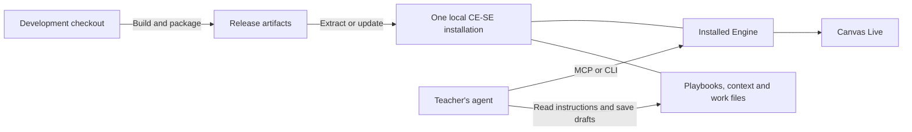

# Architecture review: folders, runtime ownership, and drift

Reviewed 2026-10-12. This is a review and proposed direction for discussion, not an approved implementation handoff. Evidence comes from source, Git history, package contents/hashes, selected client registration paths, running process paths, and read-only connected MCP calls. No Canvas requests, private identity reads, teacher-data changes, or client configuration changes were made.

Documentation follow-up approved 2026-10-12: the names **Source**, **Install**, and **Sync** are adopted. New Quizzes and written-response scoring are open for regular use within implemented limits. The source architecture/scoring contracts, teacher instruction seeds, embedded format reference and capability classification have been reconciled; the contradictions in finding 2 below describe the review's earlier snapshot. Remaining runtime ownership, connection handoff and launcher cleanup recommendations still require their own implementation direction. Current adoption/package evidence is recorded in [engine-capabilities.md](engine-capabilities.md).

## Answer to the folder question

The user clarified that “app folder” means the development project or `dist` folder. On that definition, there are a development checkout, a teacher installation, and an optional agent sync folder. That is the developer's physical arrangement. The teacher product still needs one local CE-SE folder, with the agent's own sync folder independent.

| Location | Owner and role | Required for a colleague using CE-SE? |
|---|---|---|
| `D:\Development Projects\CanvasExpert-SE` | Developer: source, starter files, Engine contracts, builds, release artifacts | No |
| Its `dist/` directory | Developer: generated executable, ZIP, optional MCPB | No |
| `D:\CanvasExpert-SE` | Teacher: Engine, instructions, playbooks, context, drafts, pulled work, private runtime data | Yes; the location is the teacher's choice |
| Optional agent sync folder | Teacher/agent: whatever that agent uses independently | No CE-SE requirement |
| Client configuration and Windows Credential Manager | Machine: connection settings and private credential | Machine integration; no extra teacher workspace |

The extracted ZIP **is** the installation. There is no separate installer-managed app folder required after extraction. Keeping development source separate from real teaching work is reasonable: release files are replaceable; teaching preferences and unsent/student work are not.

MCP does not require another app installation. Direct stdio registration starts the existing `engine/cse.exe mcp`. Official [OpenAI MCP documentation](https://learn.chatgpt.com/docs/extend/mcp) describes stdio servers as command-started local processes, with command/arguments and optional working directory. The project already implements that route.

One exception exists in our packaging: the optional Cowork `.mcpb` contains another Engine executable and points it at the teacher installation. That is our extension packaging choice. Today's selected registrations and running CE-SE MCP process paths point at `D:\CanvasExpert-SE\engine\cse.exe`; no observed CE-SE process runs from an extension directory. This does not prove every possible Cowork mode works through direct registration.

## Intended architecture and current fit

The main separation still holds: the agent makes educational judgments from playbooks/context; Go handles Canvas access, identity, exact math, file preservation and writes. MCP is an adapter over the same Engine commands, not a second Canvas client. `internal/mcpserver/server.go:207` launches the same executable with its selected root; local review/UI sessions do the same in `internal/mcpserver/sessions.go:70`. This process boundary is a reasonable reuse strategy. A service framework or rewrite would add cost without resolving the identified problems.

The normal installed root is also coherent. `internal/workspace/paths.go:14` binds an executable in `engine/` with adjacent `context/courses.md` to that installation and rejects a conflicting explicit root. Developer and Engine-only extension binaries retain explicit roots. WebUI folder selection and remembered-root fallback were removed. Git history records the move to one folder (`d95b102`), the local-drive constraint (`c38a07d`), and removal of the separate program-folder package (`3514273`). The two-folder arrangement was intentionally retired before MCP was added.

The drift is mainly in release/update practice and instruction consistency. It is not evidence that the two-part Engine/playbook design has failed.

## Findings, ordered by teacher impact

### 1. Release artifacts and the active executable have diverged

This is an observed mismatch, not a hypothetical update risk.

| Examined executable | SHA-256 |
|---|---|
| `dist/cse.exe` and installed `engine/cse.exe` | `3CCEB1C0EAF4A2E691358C218B5B769727660289F9CEF06D17671DF9354C7E4C` |
| Engine inside `dist/CanvasExpert-SE.zip` and `dist/CanvasExpert-SE-Cowork.mcpb` | `447443DAD0188AC9124BBCD10C464AC4E810F1F55B2B07B163D2F2E686DB8261` |

The current loose/installed executable reports revision `3074f3e734b8+dirty`, built `2026-10-11T23:16:28Z`. The release archives were last written at approximately `17:53Z` that day. The hash comparison establishes different Engine bytes; it does not establish every behavioral difference. A dirty parent revision stamp alone is not evidence that later committed functionality is absent.

`scripts/build.ps1` updates only `dist/cse.exe`. `scripts/package.ps1:23` rebuilds and produces both release formats. Neither deploys to an existing teacher installation. Ordinary development builds, packaging, installation updates and MCP reconnects are distinct steps, and recent work has left the outputs at different stages. A colleague receiving today's ZIP receives a different Engine than the local teacher installation.

**Recommendation:** define one short release/update procedure that packages the intended build, copies only program-owned files into an explicitly named existing installation, preserves teacher files, and explains client reconnects. A small development helper is sufficient. Keep loose development builds possible; do not treat their presence as an updated release. No automatic updater, service or deployment framework is needed.

### 2. Agent instructions contradict the implemented capability

`workspace-template/playbooks/score.md:13` says New Quizzes cannot be pulled for scoring. At line 26 the same playbook explains the implemented assignment-scoped New Quiz pull and comment-only assessment workflow. An agent can stop at the old prohibition, or read the ordinary grading directions as applying to a comment-only quiz path.

`ARCHITECTURE.md:85` still calls New Quiz written-work feedback planned. `ARCHITECTURE.md:65` and `SCORING-RULES.md:11` still require returned grade/rubric outcome confirmation. Current grading code treats accepted writes as succeeded without the removed post-write confirmation; the installed standing instructions tell the agent to report once and stop after posting. These authority files have not all caught up with the decisions and implementation.

Today's installed `AGENTS.md`, setup playbook and scoring playbook are byte-identical to their current source seeds. Therefore the scoring contradiction is already in the live instructions; this is not merely an unadopted update.

**Recommendation:** reconcile these specific statements around the agreed semantics: New Quiz written-work assessment posts comments only, item points remain teacher-entered, and accepted grading writes count as done. State the New Quiz branch before ordinary-assignment grading instructions. Preserve consequential pre-write identity, scope and privacy checks. Do not reinterpret this as authorization to remove content-access checks from unrelated authoring paths.

### 3. Cowork extension packaging creates an independent runtime owner

`scripts/package-mcp.ps1:17` copies `cse.exe` into the MCPB. `integrations/cowork/manifest.json:12` executes that extension copy, with an explicit installation path for data. MCP child commands and review pages then also use the extension executable. Updating the teacher's `engine/cse.exe` does not update that route.

This is a genuine exception to “CLI, WebUI and MCP use the installed Engine,” even though they can share the same teacher files. Today's MCPB also contains the older Engine hash reported above.

**Recommendation:** make direct registration of the installed Engine the canonical desktop route. Establish whether a supported Cowork workflow actually needs an MCPB before maintaining it as a normal release output. If required, decide how it will use the same authoritative installed Engine; feasibility of a launcher-only extension remains unverified. Do not remove a needed route merely to improve the folder count.

### 4. First-run MCP connection still depends on developer material

The packaged README says to connect through MCP or open the installation in a local agent. The exact connection helper is `scripts/connect-mcp.ps1` in the source checkout; the ZIP's 18 entries do not include it or the MCP setup guide. The setup playbook starts after the agent can already reach the Engine. Manual registration is documented in the repository, and opening the folder in a capable local agent is another available route, so this is a handoff gap rather than a universal first-run failure.

**Recommendation:** make the chosen connection route available from the released installation itself, with concrete instructions or a small helper. Preserve existing client settings. Keep this within the release/setup cleanup rather than introducing an installer.

### 5. Old two-folder mechanisms remain visible in source and launchers

The teacher launcher still falls back to `%LOCALAPPDATA%\CanvasExpert-SE\program.txt` when its local Engine is missing (`workspace-template/cse.cmd:10`). Opening a hub records its executable globally (`internal/localui/hub.go:294`). Source `webui.cmd:5` still claims the hub remembers a folder, although that behavior was removed. `PickFolder`, `SeparateFrom`, and the Go `LinkedProgram` reader have no non-test Go callers in this checkout; the batch launcher does consume the pointer.

The complete installed folder uses its own Engine first, so these remnants are not a demonstrated failure in the normal route. They do, however, keep the retired separate-program model alive and complicate explanation of incomplete packages and developer launches.

**Recommendation:** simplify the teacher launcher to its bundled Engine and keep developer roots explicit, if that direction is agreed. Remove the unused picker and related obsolete helpers as part of that bounded change. This is secondary cleanup, not a prerequisite for feature use.

## What today's local checks establish

Both selected saved client registrations target `D:\CanvasExpert-SE\engine\cse.exe` with root `D:\CanvasExpert-SE`. All three observed CE-SE MCP processes also report that executable/root path. Connected `list_courses` returns that root and three configured, current courses. Connected `engine_info version` returns the same build information as the installed/loose executable. These operations use local configuration and metadata, not Canvas.

There is an important measurement limit: `engine_info` obtains version output from a child command, so it does not prove that a long-running server's already-loaded adapter code is the same generation. No review, post, authoring, module-read or New Quiz workflow was exercised here. The earlier review-message failure remains historical evidence pending a current review check. Today's metadata should not be presented as full client compatibility or Canvas Live proof.

The capability records are updated alongside this review to distinguish current local path/version/configuration observations from earlier checks and remaining human validation. The installed executable and teacher files have not been changed by this review.

## Direction proposed for agreement

Keep the development checkout separate and keep one local teacher installation. All CE-SE teacher files stay there. Optional agent sync remains independent; CE-SE currently provides no automatic teacher-workspace synchronization.

Use one authoritative installed Engine for normal CLI, WebUI and desktop MCP routes. Complete a bounded consolidation slice before adding more features: reconcile the actual instruction contradictions, make release/update and initial connection concrete, and resolve the extension's runtime ownership. Remove obsolete two-folder glue within that slice where it no longer serves a supported route.

The next implementation handoff should cover those specific files and outcomes after agreement. Relevant verification would be package/installation Engine identity, bundled-root and teacher-file preservation checks already available, focused connection-helper checks, and one actual client review round trip. Broad Engine retesting, another operation framework, migrations of real teacher data, and new Canvas content are not required for this architecture cleanup.
