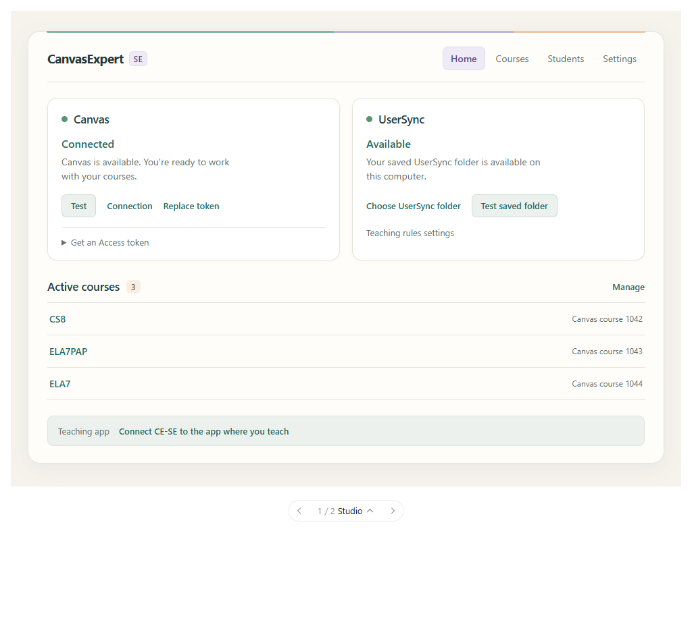

> **Retired 2026-10-16 — implemented in Dev.** Historical design/preparation instructions follow; do not execute them again. Implementation and local verification are recorded in section 14; the subsequently authorized local UserInstall update is recorded in section 15. Teacher visual acceptance, actual UserSync provider delivery, and district-PC observation remain pending. No release was published.

# Handoff: Studio light mode and a remembered Light/Dark switch

Prepared 2026-10-16. **Preparation status at handoff time: design approved; implementation not yet started.** Repository inspected at commit `d707ffb`; recheck the relevant files before implementing because other work may have landed.

This handoff belongs to the **Engine's local WebUI and reusable teacher preferences**. It introduces no educational judgment, Canvas operation, scoring rule, or agent workflow. This preparation session changes documentation and preserves visual references only.

## 1. Outcome and the user's priorities

The user likes the current practical “Bench” WebUI and wants a lighter, more enjoyable appearance without making it silly or breaking functionality. They approved the Studio mockup enthusiastically, then simplified the product direction:

> “We could just make this the light mode and have a light/dark switch. Possible?”

The agreed answer was:

- **Light:** the approved Studio appearance—warm cream, white cards, teal controls, restrained lavender and apricot accents.
- **Dark:** use the existing dark palette as the starting point, with matching restrained corner and surface styling.
- **One Light/Dark switch**, with an explicit choice remembered across restarts.
- **Follow the computer's appearance until the user explicitly chooses.** An untouched preference continues to follow the system.
- Use the same pages, navigation, forms, content, and actions in both modes.

The user's original warning was: “Make no changes, the last thing I want is to actually break functionality.” They subsequently authorized a visual mockup and this detailed handoff. **They have not asked this session to implement the application changes.** A future session can implement when asked; it need not reopen the settled visual direction.

The earlier proposal of a separate “Bench”/“Studio” theme selector is superseded. Do not ship a theme gallery, retain an extra Bench light option, or build a second product layout. Studio becomes the normal light appearance. The labels in the product are **Light** and **Dark**; “Studio” is the design reference name.

## 2. Read before implementation

Read the current versions of:

1. Root `AGENTS.md`.
2. `ARCHITECTURE.md` and `SCORING-RULES.md`.
3. `internal/localui/README.md` for page registration, CSP, rendering, and script declarations.
4. This handoff and its visual references.
5. `docs/build.md` and `docs/releasing.md` before building a distributable.

Use **Dev**, **UserInstall**, and **UserSync** consistently. Implement in Dev. A real teacher's installation, private data, credentials, connected clients, and Canvas content are outside the implementation scope.

The project asks the senior planning agent to hand bounded coding work to an implementation agent after direction is agreed. **One Sol implementation agent will execute this handoff**, followed by focused review of the result. If you are that execution agent, implement directly; do not delegate again. The phases below are sequencing for one task, not separate approval gates or a request for parallel worktrees. Continue through implementation and local validation without reopening the approved visual direction.

## 3. Preserved visual references

These documentation assets accompany the handoff:

- [Approved Studio desktop reference](assets/studio-appearance/studio-light-reference.png).
- [Mockup source fragment](assets/studio-appearance/studio-theme-mockup.html).



The source fragment is an in-conversation visualization, **not a production page or drop-in template**. Its carousel, optional `Tweak` bindings, preview-only clicks, sample statuses, and sample course IDs belong only to the mockup. Do not copy those behaviors into the product or ship a visualization runtime. It can be read directly for colors and styling; its host controls require the visualization environment.

The image includes the original preview's comparison controls. Those are not product UI.

All displayed connection statuses and numeric course IDs in these references are synthetic. They establish no current Canvas connection, UserSync availability, or live capability.

### Important differences between the reference and the real UI

- The mockup's simplified top navigation is Home / Courses / Students / Settings. The **real** page registry has Home / Classroom / Settings / Guide, with Courses and Students under Classroom. **Preserve the real navigation.** This task does not rename or reorganize it.
- Keep real server-generated health labels, status keys, course names, IDs, and helper text. The mockup's prose and green dots are examples, not new product truth.
- In particular, do not mark UserSync healthy just to match the image. Preserve its actual state and the distinction between local folder availability and provider delivery.
- The actual hub has standard and wide page widths. Preserve those widths and table behavior; do not replace them with the mockup's approximate dimensions.
- The image demonstrates light mode. A corresponding dark mockup has not been approved or rendered. The agreed dark starting point is the existing dark palette, with shared visual polish.

## 4. Visual specification

### Light palette

Use the reference's values as starting points. Adjust a value where actual contrast or an existing state requires it, while retaining the overall appearance.

| Role | Reference value | Intended use |
|---|---|---|
| Page background | `#f6f3ed` | Warm cream around the main surface |
| Main surface | `#fffdfa` | Slightly warm near-white |
| Card / field surface | `#ffffff` | Clear content surfaces |
| Main text | `#263a39` | Dark, readable text |
| Secondary text | `#63716d` | Helper text and quiet metadata |
| Neutral border | `#e4e4db` | Dividers and card edges; strengthen fields as needed |
| Main accent | `#216c65` | Teal links and controls |
| Soft accent surface | approximately `#edf1ee` | Pale teal tint, subordinate to text and controls |
| Selected navigation surface | `#eeeaf6` | Restrained lavender |
| Selected navigation text | `#5d4d82` | Readable violet text on lavender |
| Selected navigation border | `#e2dbef` | Quiet boundary |
| Count highlight | `#faeee2` | Small apricot accent |
| Count text | `#6b5945` | Text on the apricot fill |
| Decorative edge | `#82b7a6`, `#c3b2db`, `#ecc8a6` | Thin teal/lavender/apricot rule above the hub surface |
| Main shadow | `0 8px 30px #354c3910` | Very subtle depth |

The mockup initially declares `#eaf4ef` for its soft accent and then derives the displayed fill from an 8% mix of the teal accent with `#fffdfa`. Match the **rendered reference**, not whichever unused declaration is easiest to copy. Fixed CSS values are fine; a color-mixing feature is not required.

Do not repurpose the decorative palette for success, danger, waiting, held, or teacher-only meaning. Retain distinct semantic colors and readable state text. The existing base stylesheet already supplies those roles.

### Shapes, spacing, and typography

- Preserve the compact, useful character of the current WebUI.
- Use system fonts; no new font downloads or icon library.
- Cards are approximately 14px radius and the hub outer surface approximately 18px in the reference. Controls remain smaller, around 6–8px.
- Use modest spacing around the hub header, status cards, course list, and teaching-app row. Do not enlarge dense student tables into decorative dashboards.
- A small lavender SE badge, selected navigation fill, apricot course count, pale teal teaching-app strip, and thin multicolor top rule provide personality.
- Decorative additions must not cover content or intercept clicks. A pseudo-element top rule should be noninteractive.
- Avoid decorative assets, mascots, confetti, new animations, sound, jokes, and large hero headings.
- Preserve visible focus rings, disabled states, readable field borders, and clear interactive affordances.

### Dark appearance

Start with the current base stylesheet's dark values:

```text
page          #171a18     surface       #222724
surface-soft  #282e2a     ink           #e7ebe7
muted         #afb8b0     line          #414a43
accent        #a5c5b2     accent-soft   #2a3b31
danger        #ffaaaa     danger-soft   #452c2b
good          #a4d4b1     focus         #8ab7f4
mark-good     #6fb585     mark-bad      #d97b7b
mark-wait     #d4a24c     field-line    #66726a
```

Retain the existing review-specific dark privacy colors as a starting point: `--private:#353326`, `--private-line:#9c8c54`, and the correct dark foreground on filled accent buttons.

Apply the same restrained shape language. Tune new lavender/apricot accents for dark surfaces rather than leaving bright light-mode patches. Shadows should stay subtle or disappear where they do not help.

## 5. Appearance behavior

### Stored mode versus effective mode

Keep two concepts distinct:

- **Stored preference:** absent/system, `light`, or `dark`.
- **Effective appearance:** always light or dark, based on an explicit preference or `prefers-color-scheme` when none is saved.

Stored explicit values are lowercase `light` and `dark`; display labels are Light and Dark. Missing preference means system, without a migration or first-run write.

| Situation | Expected behavior |
|---|---|
| No saved choice; OS light | Studio light appearance |
| No saved choice; OS dark | Dark appearance |
| No saved choice; OS changes while page is open | Follow the OS |
| Explicit light choice; OS dark | Remain light |
| Explicit dark choice; OS light | Remain dark |
| New navigation, new window, restart, different loopback port | Read the saved choice from active teacher setup |
| Another UserInstall uses the same configured UserSync | Read the same saved choice after provider delivery |
| A page was already open when another page saved a choice | Picking it up on next navigation/open is sufficient |

No polling, cross-tab broadcast system, or service worker is required. Do not expand this into appearance scheduling or per-course preferences.

### The switch

Put a compact, clearly labeled Light/Dark control in the shared hub header, reachable from every hub page without visiting Settings. Use an equivalent compact control in the standalone student and review headers when their UserInstall is known. A workspace-aware setup page should receive the same choice; a rootless bootstrap page can follow the OS without offering a persistent save it cannot target.

Use a native button or native checkbox with appropriate switch semantics, accessible state, and visible mode text. For a button, use `type="button"` explicitly. The review header lives inside the posting form, so an untyped button could accidentally submit work.

There is one mode switch, not a Bench/Studio picker or an appearance customization panel. Settings may explain the saved preference and its UserSync location if useful, but do not duplicate the mode controls unnecessarily. A separate “use computer setting again” reset control was not requested and is not necessary for the first implementation.

Changing appearance must:

1. Update appearance in the current page without navigation or replacement of the page DOM.
2. Save only the appearance preference through a dedicated local endpoint.
3. Leave all unsaved fields, open disclosures, review choices, and revision notes intact.
4. Leave posting, sending, credential saving, and student/course saving entirely under their existing actions.

Do not implement the switch as a full-page POST/redirect or reload. Settings and student forms have draft retention, but review notes and other live controls must also survive. This requirement prevents a concrete loss of unsent work.

A simple one-request-at-a-time save is sufficient: apply the selected mode immediately, disable only the appearance control while its request is pending, and re-enable it when the request settles. Do not disable the surrounding form or delay its existing actions. Do not introduce a queue or retry framework. If saving fails, retain the selected appearance for this page and explain that it could not be saved; do not claim persistence or replace the previous stored preference. The page's temporary explicit choice should continue to override OS changes until navigation. Show save feedback beside the control in an accessible status region without replacing existing page errors or notices.

## 6. Persistence design

Use the existing teacher-setup resolver and plain-file I/O. Store the preference in **a small optional `context/appearance.md` document**, created only when a preference is explicitly saved:

```yaml
---
schema: 1
mode: light
---
```

`mode: dark` selects dark. An absent file or an omitted/empty mode means system. Save accepts only `light` or `dark`; other nonempty values are invalid. A small local struct for the document is enough.

Why this uses a separate document:

- `context/` already resolves to UserInstall or configured UserSync through `ResolveTeacherPath`.
- The preference follows the existing shared authority without a new storage mechanism or migration.
- Existing course/alias/Canvas-origin writers keep operating on their existing schema.
- `workspace.ParseDocument` uses strict document decoding. Adding a new field to shared `context/courses.md` would also require care for older Engines that read that same file. A separate optional document avoids creating that compatibility problem for a cosmetic feature.

Use this path for the implementation; no further storage-design decision is needed. Do not build a general preferences framework.

Rules:

- Resolve the active authority before reading or writing. Use `workspace.ResolveTeacherPath`, `ReadTeacherDocument` / `WriteTeacherDocument`, or the underlying existing document helpers appropriately.
- Distinguish a missing optional preference **after successful authority resolution** from an unavailable configured UserSync directory. Do not treat every wrapped “not found” error as an absent preference.
- Do not read an inactive local copy when configured UserSync is unavailable.
- A cosmetic read problem must not disable review/posting or hide an existing setup error. It is acceptable to render with the system palette as a presentation fallback while reporting that the preference could not be read. This does not mean loading stale local settings or rebinding the authority.
- A failed save must not create a local fallback file, reset unrelated settings, or replace a configured UserSync binding.
- Reuse existing atomic file writes. Preserve any body text if a teacher has annotated the preference document.
- Read the active preference afresh for page requests/new windows rather than caching it indefinitely in a process global.
- Do not create or edit the file merely because a page opens or the OS mode changes.
- No required starter seed is needed for an optional file. Do not make existing installations adopt a new seed or replace teacher files to obtain light/dark support.
- Browser storage is not the durable authority. It is origin-scoped, and review/student/setup servers may use different ports.

## 7. Relevant current code

| File or area | Current responsibility and implementation implication |
|---|---|
| `internal/localui/assets/base.css` | Shared light/dark colors; current dark branch uses only `prefers-color-scheme` |
| `internal/localui/assets/hub.css` | Main hub layout, navigation, forms, student tables, status marks, drafts notice |
| `internal/localui/assets/review.css` | Review cards, semantic states, privacy sections, sticky action footer; has its own dark media query |
| `internal/localui/assets.go` | Embeds CSS/templates/scripts; builds global `pageCSS` and `reviewCSS`; defines template functions; serves local JS |
| `internal/localui/theme.go` | `hubNavFor` generates primary/sub-navigation from the registry; it is not currently a theme preference system |
| `internal/localui/pages.go` | Registry, methods, script/template consistency check, route-derived headers and navigation |
| `internal/localui/hub.go` | Main loopback hub, origin/secret checks, CSP, preferred port with fallback, final hub-close page |
| `internal/localui/hub_shared.go` | Buffered `h.render`, config read, redirects, workspace checks |
| `internal/localui/home.go` | Home data and shared `pageData`; not every page uses this data type |
| `internal/localui/settings.go` | Separate Settings sections; current `/settings` POST saves aliases |
| `internal/localui/courses.go` | Course data has its own view struct; real Classroom navigation is declared here |
| `internal/localui/setup.go` | Hub setup and separate one-shot setup server; root is not part of current `SetupForOrigin` signature |
| `internal/localui/students.go` | Hub and standalone student editors share templates but have their own handler/data path |
| `internal/localui/review.go` | One-shot review server; independent rendering, error/outcome pages, origin/secret checks; shared with parent-email review |
| `internal/localui/templates/*.html` | Current full-page templates use `pageCSS` or `reviewCSS`; preserve form/action semantics |
| `internal/localui/assets/drafts.js` | Tab/session-scoped unsaved field storage; not a persistent appearance store |
| `internal/localui/assets/contacts.js` | Contact-row edits and contact draft behavior; do not disturb its bindings |
| `internal/localui/assets/canvas-health.js` | Existing health polling and state updates; appearance is independent of this behavior |
| `internal/localui/print.go` | Separate printable student-report documents/PDF path; leave report colors and output alone |
| `internal/workspace/rules_location.go` | Active UserInstall/UserSync authority and shared `context/` routing |
| `internal/workspace/reusable_data.go` | Existing teacher document helpers and shared setup support |
| `internal/workspace/document.go` | Strict parsing and atomic document writes |
| `cmd/cse/main.go` | Setup command already determines `setupRoot` but currently passes only the origin into the setup UI |
| `cmd/cse/remote.go` | Both ordinary and parent review call sites already have the resolved `root` |
| `internal/localui/capabilities.go` and `docs/engine-capabilities.md` | Must stay aligned when actual UI capabilities/evidence change |

Inspect current call sites before editing. Avoid cleanup of unrelated historical code, including unused cosmetic helpers. This handoff is not authorization for repository reorganization.

## 8. Implementation shape

### Phase A: preference and explicit palette resolution

1. Add a small appearance read/write helper using the storage design above.
2. Introduce request-local appearance data sufficient to render an explicit root mode, current preference state, and the save control when a root is available.
3. Make the new Studio values the default light CSS.
4. Apply the dark palette automatically only when there is no explicit mode and the OS requests dark.
5. Apply explicit light/dark at the document root, for example `data-appearance="light"` or `data-appearance="dark"`, with matching native `color-scheme`.

Do not leave an unconditional dark media query able to override explicitly selected light. Audit **both** base and review styles: the existing review media query independently changes private-note colors and primary-button foregrounds.

All semantic colors should follow the same mode rules. A small number of tokens for navigation fill, count fill, radii, and shadows is appropriate. Do not build a token generator or external theme package.

The current `pageCSS` and `reviewCSS` globals hold immutable shared CSS. Keep those immutable; put mode selection in request/page data and CSS selectors. Never mutate global CSS or template functions per request to hold a teacher's selection.

### Phase B: switch and dedicated save endpoint

Add `internal/localui/assets/appearance.js` and a narrow POST route at `/_cse/appearance` on each root-aware active server:

- Send `application/x-www-form-urlencoded` with exactly `request_secret` and `mode`, using `URLSearchParams` or equivalent encoding. Construct this body explicitly; do not serialize the enclosing review/setup/student form.
- Exact same-origin and per-server secret checks apply.
- Reuse the existing bounded form parsing and validation patterns; route this request separately from the page's ordinary action handler.
- Validate the mode and write only the optional preference document.
- On a completed save, return HTTP 200 with JSON `{"mode":"light"}` or `{"mode":"dark"}`. Return non-2xx for failures, without a page redirect. The script must handle both JSON errors and existing plain-text validation errors without injecting server text as HTML; a concise local failure message is sufficient. Confirm success only after the write succeeds.
- Use request-local data/attributes for the secret and saved mode. Keep them out of draft persistence and logs.
- Keep the switch state accessible and responsive to the OS while the preference is unset.
- A switch action must not invoke the build/post/test/send callbacks of a review handler.

Do not send the appearance form to the existing `/settings` alias-saving handler. That handler currently derives `Aliases` from its submitted checkbox; reusing it with only an appearance field could change an unrelated preference.

Serve the script through the existing embedded asset mechanism. No CDN, package manager, front-end framework, or external image/font is required.

### Phase C: hub and standalone coverage

Cover all actual UI entry points, not just the Home mockup:

- Home.
- Classroom / Courses and Classroom / Students, including contact details and private notes.
- Settings sections, connection setup, agent connection page.
- Guide / How it works and Capabilities.
- Standalone student editor.
- Ordinary scoring, assignment, quiz, and edit reviews.
- Parent-update email review, which shares `review.go` and the review template.
- Relevant success, error, saved, completed-review, and hub-close pages rendered outside the ordinary templates.

**Active pages get the switch; terminal pages get the palette only.** Students-saved, standalone setup-success, review-finished, and hub-closed responses are followed by server shutdown. Render their appearance attribute and embedded CSS in the response, omit the appearance control and external scripts, and preserve the existing shutdown behavior. Do not keep a server alive or require subsequent asset/save requests for these pages. Error pages should retain the resolved palette when available; they do not need a switch. Existing plain-text HTTP errors may remain plain text. Terminal pages use the latest successfully saved preference (or system fallback); carrying an unsaved page-only choice across form submission is outside scope.

Not every view embeds `homeData`, and not every page uses `h.render`. Add only the small presentation data each owner requires, using a shared private helper/struct if useful. Do not force course/student/review views into `homeData` merely to obtain appearance fields.

For one-shot review/setup/student servers, pass the already resolved UserInstall root explicitly from their caller or a narrowly scoped internal option. `Review` and `ReviewWithTest` currently do not accept it, and `SetupForOrigin` only accepts the origin. Make the small call-site changes needed for appearance; preserve CLI/MCP commands, outputs, lifecycle behavior, and review callbacks.

Do not guess the root from the browser's port, working directory, credential store, or an untrusted results-file path. Do not connect a standalone appearance save to whichever other hub happens to be listening on the preferred port.

A genuinely rootless setup/bootstrap invocation can use system appearance. It must still let the teacher connect Canvas without a new appearance prerequisite. If rootless compatibility wrappers remain for internal callers/tests, their system-default behavior should be explicit.

Small direct helpers are enough. Do not replace the page registry, introduce middleware infrastructure, or redesign the review-server APIs beyond the root/presentation information this feature needs.

### CSP and registration details

These are existing constraints to honor, not reasons to weaken the UI's security model:

- `page.Scripts` and literal script references in its template must agree. `checkScripts` panics at initialization if a script is undeclared or declared but absent. Update declarations with the templates.
- The current checker scans each template's literal source; adding a script only inside an included subtemplate may need appropriate handling. Prefer the simplest solution compatible with the existing checker.
- Main hub CSP currently adds `connect-src 'self'` only for `page.Connect`, which also triggers Canvas health checks. The new appearance POST needs local connection permission on pages using it. **Do not set `Connect: true` on every page just to permit the switch.** Keep health behavior independent, using a small header/metadata adjustment for local appearance requests.
- Standalone students already serve embedded JS. Standalone setup currently has no script permission. Review currently permits its inline behavior script but does not serve a shared appearance script. Wire local script serving and local connection permission where required, retaining existing protections.
- Keep exact loopback Host/Origin validation, request secrets, method rules, body bounds, iframe sandboxing, `form-action`, and frame-ancestor protections.
- Changing a palette must not change review token/digest inputs or make reviewed work appear modified.

### Phase D: visual polish

Apply the approved surface/nav/card treatments to the real HTML after shared appearance switching works. Keep existing IDs, input names, `data-*` hooks, hidden fields, form methods/actions, and page registration intact.

Audit hardcoded colors only where they affect the new palettes. Examples already present are review warning borders and a fallback contact-row border. Replace a concrete mismatch with the appropriate token; do not turn this into a complete CSS cleanup project.

The theme styles the surrounding review UI, **not the teacher-authored Canvas content inside sandboxed preview iframes**. Do not rewrite that content to look like Studio. Printed student reports should keep their current report-specific presentation.

## 9. Preserve these behaviors

These boundaries matter directly to the user's concern about functionality:

- No appearance action posts to Canvas, saves credentials, changes course selections, edits student data, or sends/drafts an Outlook email.
- Save appearance without navigating away or replacing unsent form/review state.
- Preserve truthful review summaries, proposed grades, criterion scores, held items, approved/revise decisions, extra actions, and explicit posting scope.
- Keep teacher-only sections clearly labeled and visually distinct in both modes. Do not change what is included in student feedback or emails.
- Preserve contact row add/remove, destinations and independent channel choices, phone formatting, and invalid-entry retention.
- Preserve draft restoration and clearing boundaries; appearance does not join a draft group for aliases, grading voice, sync path, courses, or students.
- Do not turn a preference-read failure into a new requirement before ordinary teaching work.
- Existing installations with no appearance file should work immediately. No setup wizard, folder migration, CLI/MCP registration change, or teacher-file replacement is necessary.
- The installed executable embeds these assets. Editing CSS in Dev does not update a teacher's running UserInstall until a newly built Engine is intentionally installed.

No Canvas probe, email test, real credential change, or real UserSync binding is needed to verify a cosmetic feature. Use isolated local fixtures and fake transports/senders.

## 10. Proportionate validation

Reuse the existing tests. Add focused regressions for the changed behavior; do not write source-text architecture tests, snapshot baselines, coverage quotas, or a combinatorial matrix.

### Focused Go checks

Useful tests should establish:

1. Missing preference defaults to system without creating a file; saving and re-reading light/dark works.
2. Local and configured UserSync use the correct authority, including a second synthetic UserInstall reading the choice. Unavailable authority does not cause a local preference write. Existing course config and other setup remain unchanged.
3. Appearance POST rejects a wrong origin/secret or unsupported mode without saving; an authorized mode save affects only appearance.
4. The rendered explicit preference reaches a hub page with its own data struct and a separate review page/server. Cover standalone plumbing through existing tests where practical, rather than duplicating every template test.

Current tests worth reusing or extending include:

- `internal/localui/pages_test.go`: navigation, CSP, buffered rendering.
- `internal/localui/settings_test.go`: section-specific forms and draft scope.
- `internal/localui/review_test.go`: honest/private review rendering, revisions, changed-file checks, secret checks, extra actions and test action.
- `internal/localui/students_test.go`, `contacts_test.go`, and `drafts_test.go`: relevant existing editor behavior.
- `internal/workspace/reusable_data_test.go` and `rules_location_test.go`: routing patterns and fixture helpers.

If the new preference helper lives in `localui`, its storage tests can live there while exercising the existing workspace resolver. Do not move code into a new abstraction just to match this list.

### Browser inspection and behavioral smoke check

Use synthetic pages/data. Inspect desktop around 1024px and narrow around 375px; spot-check 320px if wrapping is tight.

- Compare Home light mode with the preserved image, retaining the real navigation and current server data.
- Check OS-default light and dark, then explicit light under an OS-dark browser and explicit dark under an OS-light browser. This catches the existing media-query override risk.
- Check a dense Students page with expanded contacts/private notes and the Settings preference fields.
- Enter an unsaved value, switch modes, and verify the input remains. In review, set Revise and type a note, then switch; keep both state and text.
- Verify the switch does not submit its enclosing form or call post/send/test callbacks. Use fake callbacks with observable call counts.
- Verify keyboard focus, switch state/label, native field appearance, disabled buttons, status/warning/held states, and private-note distinction in both modes.
- Open a new standalone review on a different port and verify the saved explicit choice is applied on initial render.
- Check that a save failure is visible and does not remove work or claim a persisted preference.
- Check one terminal response retains the saved palette with no appearance control or external script dependency; retain the existing server-shutdown checks.
- Watch for CSP failures, JS errors, clipping/overlap, and unwanted flashes caused by applying the explicit mode too late.

No new screenshot test system is needed. A short local browser script or manual synthetic inspection is sufficient for visual acceptance, with evidence reported honestly.

### Commands and build expectations

Use the Go version in `go.mod` and the repo's documented build path. At preparation time the local toolchain is `.tools/go1.27.1/go/bin/go.exe`; recheck availability.

For example, after edits:

```powershell
& '.\.tools\go1.27.1\go\bin\go.exe' test ./internal/localui ./internal/workspace
```

Include any additionally changed package in targeted checks. Format only edited Go files. When preparing the normal Dev distribution, the existing packaging producer runs full tests and vet:

```powershell
.\scripts\build.ps1 -GoExecutable '.\.tools\go1.27.1\go\bin\go.exe'
```

Consult the current build/release docs for authoritative commands. Do not install a new runtime, modify PATH, or use the teacher's UserInstall as a build fixture.

## 11. Capability and documentation updates

When the behavior is implemented and checked, update **both** `internal/localui/capabilities.go` and `docs/engine-capabilities.md`, with their review date, as root `AGENTS.md` requires.

Describe the actual feature and evidence: Studio light appearance, existing dark palette, explicit switch, saved active-authority preference, and local browser/test coverage. Do not imply Canvas Live proof, provider delivery, district-PC validation, or human acceptance from synthetic checks.

Add a short architecture/user-facing note about `context/appearance.md` and unset/system behavior where a future maintainer can find it. Avoid a new top-level policy document or extensive playbook changes for an appearance control.

This handoff session itself does **not** update capability status or review dates, because the feature has not been built.

## 12. Delivery and stopping point

Implement in Dev, inspect the working UI locally with fixtures, run relevant checks, and report a reviewable diff plus visual evidence. Build the normal Dev ZIP when requested or part of the implementation task, using the normal producer.

Do not update the real UserInstall, repoint app registrations, change UserSync, publish a release, create a release tag, or perform Canvas/Outlook operations merely to demonstrate the theme. Follow the actual future user request for any installation or release step. Completing a Dev preview does not require a production rollout.

Once implementation is genuinely complete, update this handoff with the actual changed files, validation performed, and remaining human review. Retire it under `handoffs/retired/` according to `handoffs/README.md` when complete or superseded; do not retire it because a plan was written.

### Acceptance criteria

- [x] Studio is the normal light appearance; no extra Bench/Studio selector is introduced.
- [x] Dark uses the existing dark palette with compatible shared styling.
- [x] One accessible Light/Dark control is available in the relevant active UI chrome.
- [x] Unset follows the OS; explicit choices override it and survive restart/new ports.
- [x] The choice uses the active teacher-setup authority and works across synthetic UserInstall folders sharing UserSync.
- [x] Appearance is applied consistently to the hub and standalone review/student/setup paths where a root is known, including relevant final/error pages.
- [x] Terminal pages retain the saved palette without a switch, external script dependency, or server-lifetime change.
- [x] Mode changes preserve unsaved editor and review state and invoke no unrelated action.
- [x] Saving disables only the appearance control; failure keeps the page usable, retains its temporary mode, and reports that persistence failed.
- [x] Existing navigation, forms, IDs/hooks, scopes, grading, privacy, and posting/sending behavior are preserved.
- [x] Light and dark remain readable, keyboard-usable, and clear about warning/private states.
- [x] Relevant local checks pass; capability records state only the evidence actually obtained.
- [x] Application work stays in Dev until an actual install/release step is requested.

## 13. Preparation-session evidence and resume prompt

What was actually done before implementation:

- Read the development authority and relevant UI/routing/persistence/build sources.
- Built the standalone Studio mockup outside the application checkout; user approved its appearance.
- Rendered that mockup with the bundled visualization renderer and checked it in headless Microsoft Edge through Playwright at desktop/narrow widths. No JS errors or horizontal overflow were reported; the disclosure and inert preview-action notice worked.
- Those checks were of the **mockup only**, not an implemented WebUI theme or preference switch.
- Preserved the approved desktop screenshot and mockup fragment beside this document.
- No application code, real teacher setup, Canvas content, client registration, credentials, or running UserInstall was changed. No Go implementation tests were run for this documentation-only handoff.

Pre-execution review (2026-10-16): checked the handoff, approved image, and relevant implementation at `d707ffb`. Clarified terminal-page behavior, fixed the small storage/endpoint contract, and specified pending/failed-save behavior for one Sol execution agent. These are documentation changes only; implementation and its validation remain outstanding.

Suggested future-session instruction for the Sol execution agent:

> Read `AGENTS.md`, `ARCHITECTURE.md`, `SCORING-RULES.md`, and `handoffs/active/STUDIO-LIGHT-DARK.md`. You are the Sol execution agent for this approved handoff: implement it directly in Dev without further delegation. Complete the Studio light appearance and remembered Light/Dark switch, preserve existing behavior and unsaved work, validate with local fixtures, and show the working result with a concise changed-file/test summary and light/dark visual evidence for focused review. Keep the real UserInstall, UserSync, Canvas, Outlook, and client registrations untouched. Do not publish a release.


## 14. Implementation and validation (2026-10-16)

Completed in Dev by the execution agent, with bounded CSS implementation and a focused read-only review by a subagent authorized by the user's execution request. No unresolved code-review findings were reported. Human visual acceptance is still invited; the completed checkboxes describe implementation plus local evidence.

Changed areas:

- `internal/localui/appearance.go`, `assets/appearance.js`: optional strict `context/appearance.md`, active-authority resolution, body-preserving atomic saves, per-response appearance, accessible switch and separate bounded same-origin/secret-checked save route. No browser storage or unrelated form serialization.
- `assets/base.css`, `hub.css`, `review.css`: Studio light colors, shared restrained shapes, dark semantic colors, explicit modes overriding system appearance, readable private/warning/held states and fields. Print reports and sandboxed authored content retain their existing presentation.
- Hub/navigation, owner view structs and all nine page templates: initial root mode, one switch on active pages, embedded script declarations and local connection permission independent of Canvas health checks.
- `setup.go`, `students.go`, `review.go`, `cmd/cse/main.go` and `remote.go`: explicit resolved UserInstall for standalone pages, including ordinary and parent email review. Terminal/error responses retain the palette; terminal responses load no external scripts or switch and preserve existing completion/shutdown behavior. Rootless compatibility calls follow the system.
- `appearance_test.go`, `pages_test.go`, `hub_students_test.go`: focused preference/authority/save-isolation/standalone/terminal tests, and updated local appearance CSP expectations without enabling Canvas health on Courses.
- `ARCHITECTURE.md`, local UI README, both capability records: actual behavior and dated local evidence.
- `scripts/package.ps1`: one existing-build repair discovered by the normal producer. The public `context/parent-updates.md` starter already existed but was absent from the package allowlist; added that exact path to allow packaging. No starter content or parent-update behavior changed.

Validation performed:

- Targeted `go test ./internal/localui ./internal/workspace ./cmd/cse` passed using the repo's Go 1.27.1.
- The normal `scripts/build.ps1 -GoExecutable '.\.tools\go1.27.1\go\bin\go.exe'` producer passed full `go test ./...`, `go vet ./...`, portable Engine/launcher builds, verified archive assembly and checksums. The first attempt stopped at the missing parent-update allowlist entry after tests/vet had passed; the repaired producer then completed.
- Synthetic headless Microsoft Edge/Playwright run: **41 behavioral assertions passed**, zero JS/CSP errors. OS light/dark and live OS changes; no first-read preference file; keyboard switching; explicit light under OS dark and dark under OS light; all hub pages; persisted preference on a different standalone port; pending and failed saves; settings voice/contact/private-note/review revision retention; contact add/remove; unchanged review digest; no review build/post/test callback during switching; terminal review/setup palette with no script/control; standalone student/setup initial appearance; desktop 1024px and narrow 375px plus 320px spot checks. Dense student tables retain their own horizontal scroll. Save bodies contained exactly `request_secret` and `mode`.
- Go fixtures cover two synthetic UserInstall folders sharing UserSync, annotation preservation, unavailable authority without local fallback, correct origin/secret/mode validation, unrelated course-config preservation, and standalone student/setup/review completion. Existing tests cover review/privacy/posting, contact, draft and callback behavior. These are local checks, not Canvas Live, Outlook sending or provider-delivery evidence.
- Temporary browser servers used only fake credentials, roster/Canvas results and review callbacks. They were stopped and their temporary fixture source removed. No real UserInstall, UserSync, credentials, registration, Canvas or Outlook operation was performed.
- Visual inspection of the generated light/dark Home, Settings, expanded student contacts/private notes, review and narrow layouts found no new page overflow, unreadable states or navigation/form overlap. Sticky review actions and table scrolling retain their existing behavior.

Preserved visual evidence from the implemented UI (synthetic data):

- [Studio light Home](assets/studio-appearance/studio-light-implemented.png)
- [Dark Home](assets/studio-appearance/studio-dark-implemented.png)
- [Narrow dark Home](assets/studio-appearance/studio-dark-narrow-implemented.png)
- [Dark review with private, revised and held states](assets/studio-appearance/studio-review-dark-implemented.png)
- [Light review with retained revision and failed-save feedback](assets/studio-appearance/studio-review-light-failure-implemented.png)

Additional screenshots, the short browser smoke script and its assertion record are in ignored Dev `output/studio/`; they are local review artifacts, not shipped product assets.

Normal Dev output: `dist/CanvasExpert-SE-1.0.0-beta.1.zip`, revision `d707ffb25a09+dirty`, built `2026-10-16T15:24:55Z`, development kind. ZIP SHA-256: `c3d09783b5efd95e171a7dc0319df5e43bc78ac5335dd405cb233c9b004c2f66`. No release tag, publication or real-install update was performed.


## 15. Authorized local UserInstall update (2026-10-16)

After reviewing the implementation result, the user requested: "Update the local install, commit, and push."

Updated the active local UserInstall at `D:\Development Projects\CE-SE-fresh-test` from the tested Dev ZIP. Only `engine/cse.exe` and the generic `engine/CanvasExpert-SE-Cowork.mcpb` differed and were replaced. Other packaged program files were byte-identical. Teacher instructions, context, private runtime records, course work, UserSync and app registrations were preserved. Prior program files are backed up locally beneath `.cse/program-backups/studio-20261016-102907/`.

The installed Engine SHA-256 matches the tested Dev Engine exactly. Both a direct `version --json` call and the existing MCP adapter's child-Engine version report the new `d707ffb25a09+dirty` build from `2026-10-16T15:24:55Z`. Existing adapter processes still report their previously loaded `7ca34f61774c+dirty` build; they were left running to preserve active sessions and will adopt the new adapter on reconnect. No teacher-data, Canvas or Outlook operation was used for this update verification. File/build verification does not establish installed-browser acceptance or provider delivery.
